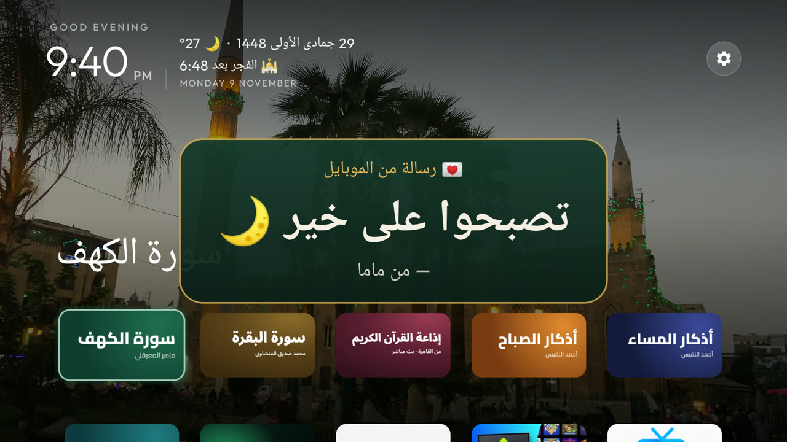
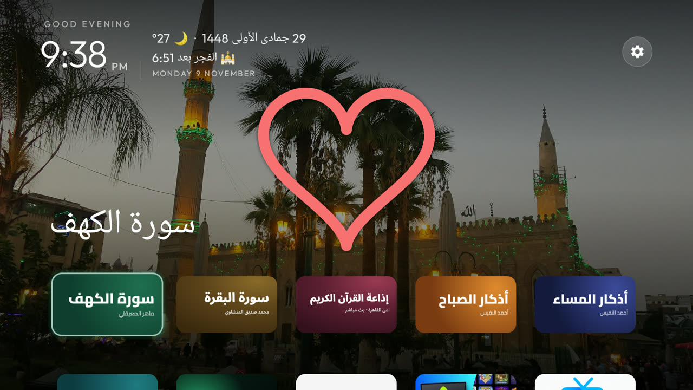
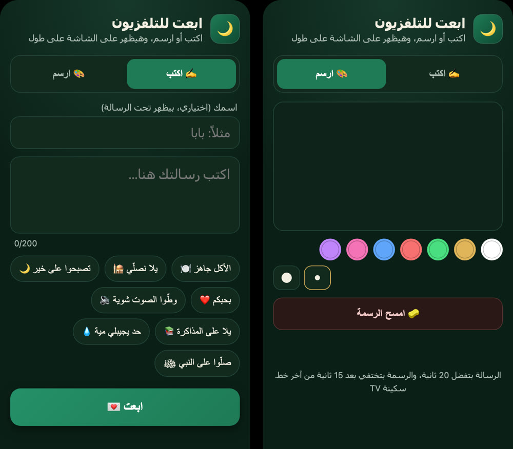
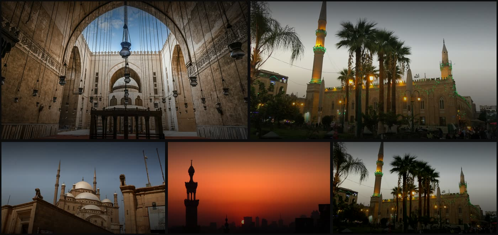

<div dir="rtl" align="center">

# 📺 سكينة TV

### نظّف تلفزيونك من الإعلانات، وخلّه يأذّن ويذكّرك بالصلاة

كلود يسوي كل شي، ويمشّيك خطوة خطوة بكلام بسيط.


**[⬇️ ابدأ الحين، 3 خطوات بس](#start)**

</div>

<div dir="rtl">

## شنو بتحصل؟

<table>
<tr>
<td width="50%"><br><b>🕌 الأذان</b><br>يأذّن وقت الصلاة. ولو فيلم شغال، يطلع لك تنبيه بس وما يقطع عليك.</td>
<td width="50%"><br><b>🌿 يوم الجمعة</b><br>يذكّرك بسورة الكهف والصلاة على النبي ﷺ، وبالأيام البيض يبيّنها لك.</td>
</tr>
<tr>
<td><br><b>💌 رسالة من جوالك</b><br>اكتب «أحبك» وتطلع على التلفزيون لايف.</td>
<td><br><b>🎨 ارسم بإصبعك</b><br>ارسم قلب على الجوال ويطلع رسمك على الشاشة.</td>
</tr>
</table>

### وكمان

- 🧹 **بلا إعلانات:** يعطّل تطبيقات الشركة اللي تجمع بياناتك وتعرض إعلانات (**تعطيل مو حذف**، وترجع بأمر واحد)
- 🗓️ **فوق الساعة:** التاريخ الهجري، والطقس، والصلاة الجاية بعد كم
- 📖 **كروت بضغطة وحدة:** سورة الكهف، سورة البقرة، أذكار الصباح، أذكار المساء، الرقية الشرعية
- ﷺ **كل 45 دقيقة:** سطر صغير يذكّرك بالصلاة على النبي

## 💌 اكتب وارسم من جوالك

صفحة صغيرة تنفتح من متصفح جوالك، بلا تطبيق تنزله. تكتب أو ترسم، ويطلع على التلفزيون قدام اللي بالبيت.



| | ✍️ اكتب | 🎨 ارسم |
|---|---|---|
| **شلون؟** | اكتب كلامك واضغط «أرسل» | ارسم بإصبعك، والرسم يطلع لايف وإنت ترسم |
| **الخيارات** | لين 200 حرف | 5 ألوان، وزر «امسح» |
| **كم يقعد؟** | 20 ثانية بنص الشاشة | يختفي بعد 15 ثانية من آخر خط |

**شلون تفتحها؟** كلود يعطيك الرابط بآخر التركيب، وشكله مثل `http://192.168.0.20:8080`. افتحه من جوالك وخلّه بالمفضلة.

**جرّبها مع أهلك:** اكتب «أحبك» وأنت بالغرفة الثانية، أو ارسم قلب لعيالك وهم قدام الشاشة.

> الجوال لازم يكون على نفس واي فاي التلفزيون. والصفحة بلا كلمة سر، فأي أحد على شبكة بيتك يقدر يفتحها.

## 🎨 3 أشكال تختار منها



| الشكل | شنو يميّزه |
|---|---|
| **الزخرفة** | أخضر وذهبي، أزرار أيقونات دايرية، 4 تطبيقات بالصف |
| **مسجد الليل** | سما كحلية وهلال ومسجد، 5 تطبيقات بلا شريط |
| **أوقات اليوم** | مسجد بالصحرا، والخلفية تتغيّر مع الصبح والعصر والليل |

وتقدر تغيّر الشكل بأي وقت، أو تحط صورتك خلفية.

## يشتغل على شنو؟

✅ أندرويد تي في وقوقل تي في بس (تي سي إل، سوني، شاومي، هايسنس أندرويد، فيليبس أندرويد...)
❌ سامسونق وإل جي ما يشتغلون عليهم (أنظمتهم مو أندرويد)

## تحتاج

1. لابتوب (ماك أو ويندوز) فيه [كلود كود](https://claude.com/claude-code)
2. التلفزيون واللابتوب على **نفس الواي فاي**

<a name="start"></a>
## 🚀 الطريقة: 3 خطوات بس

**1. افتح كلود كود والصق هالسطر:**

```
نظّف تلفزيوني بـ github.com/shariefabdelmonem-netizen/sakina-tv واقرا skills/sakina-tv/SKILL.md وامشِ عليه خطوة خطوة
```

**2. سوّ اللي يقول لك.** خطوة وحدة بكل مرة. الشي الوحيد اللي تسويه بإيدك: تضغط 7 مرات بإعدادات التلفزيون عشان تفعّل «خيارات المطوّر»، وكلود يقول لك وين بالضبط.

**3. خلاص.** كلود يدوّر على تلفزيونك بروحه، يعطيك تقرير بكل شي عطّله، ويعطيك رابط صفحة الرسايل من جوالك.

<details>
<summary>تبيه كبلقن بكلود كود؟</summary>

```
/plugin marketplace add shariefabdelmonem-netizen/sakina-tv
/plugin install sakina-tv@sakina-tv
```

بعدها قول لكلود: «نظّف تلفزيوني».
</details>

## ⚠️ اقرا قبل ما تبدي

- **عطّل لا تحذف.** فيه ناس خرّبوا تلفزيوناتهم لما حذفوا تطبيقات النظام. هالسكل ما يحذف شي أبداً، يعطّل بس.
- قبل أي تغيير، تنحفظ نسخة احتياطية بجهازك، ومعاها أمر يرجّع كل شي مثل ما كان.
- كلود يستأذنك قبل كل دفعة تعطيل.
- الاستخدام على مسؤوليتك.

## شكر

مبني على [CleanYourTV](https://github.com/Gathin23/cleanyourtv) (رخصة MIT) ✨.
مواقيت الصلاة والتاريخ الهجري من [Aladhan](https://aladhan.com)، والطقس من [Open-Meteo](https://open-meteo.com).

</div>
